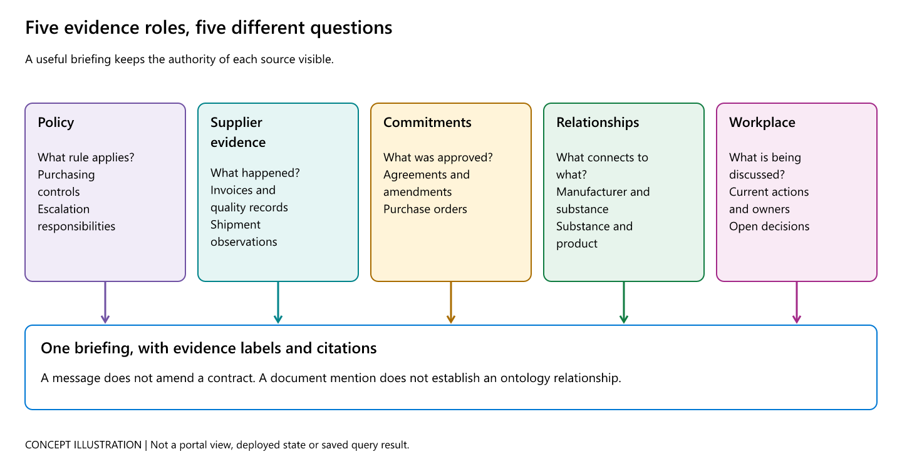
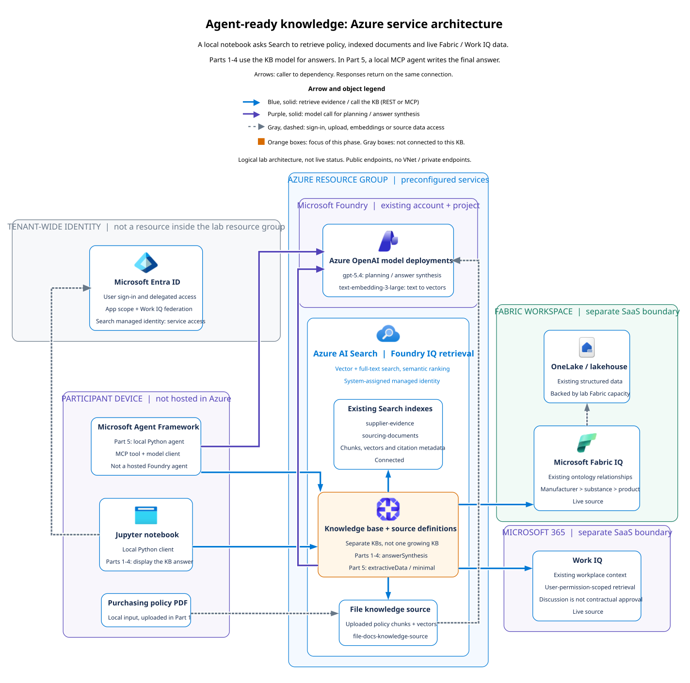

<a name="start-building"></a>

<p align="center">

</p>

# [Microsoft Frontier Tour 2027](https://aitour.microsoft.com)

## 🔥 ILL344: Turning data into agent-ready knowledge with Microsoft IQ

### Session description

Use Foundry IQ to build a multi-source knowledge base with agentic retrieval, Fabric IQ to retrieve structured data from OneLake, and Work IQ to include organizational context. Build an agent that uses their combined retrieval power to reason across files, data, and work signals.

### The bigger picture

**The problem:** an analyst needs one grounded answer, but a policy document, an invoice, a product relationship, and a workplace discussion are different kinds of evidence. This lab connects them without treating them as interchangeable.

[](img/concepts/evidence-roles.png)

**Read the evidence before the answer:** a discussion does not amend a contract, and a document mention does not establish a structured relationship. This concept illustration explains the source roles, not deployed state. Click to enlarge. The [notebook guide](src/notebooks/README.md) and [visual field guide](docs/visual-guide.md#concept-illustrations) provide optional concept explanations outside the exercises.



**Architecture in brief:** A local notebook asks Search to retrieve policy, indexed documents and live Fabric / Work IQ data. Parts 1-4 use the KB model for answers. In Part 5, a local MCP agent writes the final answer.

Read the architecture from **local client** to **Azure retrieval and models**, then to the **remote evidence sources**. Arrows point from caller to dependency. Blue means retrieval, purple means model calls, and dashed gray means identity or ingestion. Official icons identify the services. Enclosing boundaries distinguish the participant device, Azure resource group, Fabric workspace, Microsoft 365, and tenant-wide Entra ID.

**Step by step:**

1. Start with the participant device. The notebook or Python agent runs locally, not in Azure.
2. Follow the dashed gray identity arrow to Entra ID. Sign-in supplies the user authorization needed by the client and permission-scoped sources.
3. In Part 1, follow the dashed gray upload and embedding connections. The policy becomes searchable in a file knowledge source. The two document indexes already exist.
4. Follow the solid blue arrow from the client to the selected Search KB, then from the KB to its connected evidence sources. Fabric and Work IQ stay remote and are queried live.
5. For Parts 1-4, follow the solid purple arrow from the KB to Azure OpenAI. The KB uses its attached model for planning and answer synthesis.
6. For Part 5, follow the separate purple arrow from the local agent to Azure OpenAI. The agent calls an extractive KB over MCP, then writes the final answer itself.
7. Return to the notebook output. Check citations, source activity and references. Responses travel back over the same connections, so no reverse arrows are drawn.

The services and seed data already exist in the hosted lab. You mainly create objects *inside* Azure AI Search. Creating a knowledge base does not deploy another Azure service. This is the actual lab topology with public endpoints, not a hypothetical private-network production deployment. [Open the full-size architecture](img/architecture/azure-overview.svg) or its [PNG version](img/architecture/azure-overview.png).

#### Which service does what?

| Component | Its concrete job in this lab | What you create or reuse | Where to inspect it |
| --- | --- | --- | --- |
| **Azure AI Search** | Stores searchable document chunks, vectors, and citation metadata. Supports vector and full-text search with semantic ranking. It is more than a vector database | Reuse two preloaded indexes. Create knowledge sources and knowledge bases | Azure Portal, your **Search service** |
| **Foundry IQ agentic retrieval** | Uses a Search knowledge base to orchestrate retrieval over connected sources. Parts 1 to 4 attach a model for planning and answer synthesis | Create separate KB variants with different source membership | Search > **Agentic retrieval** and notebook service read-back |
| **Azure OpenAI in Microsoft Foundry** | `text-embedding-3-large` turns text into vectors. `gpt-5.4` plans and synthesizes grounded answers | Reuse the existing model deployments. A KB does not contain or deploy an LLM | Microsoft Foundry > model deployments |
| **Microsoft Fabric / Fabric IQ** | Provides structured manufacturer, substance, and medicinal-product relationships from the preconfigured ontology over OneLake data | Connect an existing workspace and ontology. Do not recreate the lakehouse in the notebook | Fabric workspace > lakehouse and ontology |
| **Work IQ / Microsoft 365** | Retrieves current workplace discussion using the signed-in user's permissions. Discussion is not automatically a contractual commitment | Connect the preconfigured identity integration and existing work context | Entra prerequisites, then Work IQ activity and references in the notebook |
| **Microsoft Entra ID** | Supplies user sign-in, delegated authorization, app scopes, and federation prerequisites | Acquire tokens. Do not publish them or recreate the lab app | Entra > app registrations, inspect only |
| **Jupyter + Microsoft Agent Framework** | Runs the client locally. In Part 5, a Python agent calls the KB through MCP and uses Azure OpenAI to synthesize its own answer | Create a local Python agent, not a hosted Foundry agent | Notebook answer and tool-call trace |
| **MCP** | A protocol that exposes the KB's retrieval tool, `knowledge_base_retrieve`, to the local agent | Configure a client for the KB's existing MCP endpoint. MCP is not another Azure service | Part 5 tool configuration and observed tool calls |

Optional Blob Storage belongs to the preparation/indexing pipeline. It is not an additional knowledge source queried by these notebooks. Fabric and Microsoft 365 remain remote sources, not copies bulk-loaded into the two Search indexes.

#### How the five parts fit together

| Part | What changes | Focused knowledge base | Who writes the final answer? |
| --- | --- | --- | --- |
| **1A: Policy** | Upload the policy and connect one file source | `caldova-policy-knowledge-base` | The model attached to the KB |
| **1B: Documents** | Connect the two existing indexes alongside policy | `caldova-supply-chain-knowledge-base` | The model attached to the KB |
| **2: Fabric** | Add structured relationships to the Part 1 sources | `caldova-fabric-knowledge-base` | The model attached to the KB |
| **3: Work IQ** | Add workplace context to the Part 1 sources, without Fabric | `caldova-workiq-knowledge-base` | The model attached to the KB |
| **4: Combined** | Connect all five evidence roles | `caldova-supply-chain-briefing-knowledge-base` | The model attached to the KB |
| **5: Local agent** | Return to the three Part 1 sources. Use an extractive KB through MCP | `caldova-supply-chain-minimal-knowledge-base` | The local agent using Azure OpenAI |

**This is a set of branches, not one KB that grows in every notebook.** Parts 2 and 3 branch from Part 1. Part 4 combines their source types. Part 5 deliberately does not use the five-source Part 4 KB.

#### Follow the same visual rhythm in every exercise

1. **Before the exercise:** read the architecture at the beginning of the notebook. Orange marks focused architecture objects.
2. **Build:** run the code. A map is a target or learning sequence, not proof that something exists.
3. **See and verify:** follow the portal path and compare the expected observation with service read-back. For queries, inspect actual activity, references, and citations.

Start with the [notebook visual guide](src/notebooks/README.md). The [visual field guide](docs/visual-guide.md) maps checkpoints to real product interfaces and explains the concept illustrations. **Twelve genuine, sanitized Azure portal screenshots are included at thirteen matching checkpoints.** If no appropriate portal view exists, no substitute screenshot is added. Concept and architecture diagrams remain clearly separate from genuine portal captures.

### 🚀 Getting started

#### In a guided session

If you're following along during a live session:

1. Open the lab environment and sign in with the provided credentials.
2. Follow the setup guidance in [`instructions/overview.md`](instructions/overview.md).
3. Open [`src/notebooks/`](src/notebooks/), start with [`part1-standard-foundry-iq-kb.ipynb`](src/notebooks/part1-standard-foundry-iq-kb.ipynb), and work through all five notebooks sequentially.

#### On your own

If you're learning at your own pace:

1. Clone this repository.
2. Provision the required resources by following the [self-deployment guide](deploy_yourself.md).
3. Follow [`instructions/overview.md`](instructions/overview.md), then work through all five notebooks in [`src/notebooks/`](src/notebooks/) sequentially.

### 🎯 Learning outcomes

By the end of this session, you will be able to:

- Build a multi-source knowledge base over indexed enterprise content using Foundry IQ (Azure AI Search) agentic retrieval.
- Extend a knowledge base with Fabric IQ and Work IQ knowledge sources.
- Build a Python agent using Microsoft Agent Framework with answers grounded in a Foundry IQ knowledge base.

### 💻 Technologies used

- Foundry IQ (Azure AI Search)
- Azure OpenAI (`gpt-5.4` and `text-embedding-3-large`)
- Model Context Protocol (MCP)
- Microsoft Fabric IQ and Work IQ
- Python and Jupyter Notebooks

### 📚 Continue your learning

Pick your next step based on your learning style:

| Resource | What you'll get |
|----------|-----------------|
| **[Session Recording](https://aka.ms/ft27/ill344/youtube)** | A recording of session ILL344 by the session creator |
| **[Foundry IQ (Azure AI Search) documentation](https://learn.microsoft.com/azure/search/)** | Explore the full capabilities of Foundry IQ (Azure AI Search) |
| **[Create a knowledge base](https://learn.microsoft.com/azure/search/agentic-retrieval-how-to-create-knowledge-base)** | Follow the steps to create and configure a knowledge base |
| **[Design an index for agentic retrieval](https://learn.microsoft.com/azure/search/agentic-retrieval-how-to-create-index)** | Learn best practices for structuring data for agentic retrieval |
| **[Microsoft Learn](https://learn.microsoft.com)** | Official documentation and guided learning paths on these topics |
| **[Frontier Tour 2027 Resource Center](https://aka.ms/FrontierTour27)** | Additional session repos and materials from Frontier Tour 2027 |
| **[Microsoft Foundry Community](https://aka.ms/MicrosoftFoundryDiscord-ft27)** | Connect with other learners and experts in our Discord community |

### 🌟 Microsoft Learn MCP Server

<!-- Remove this section if the Microsoft Learn MCP Server is not relevant to the session. -->

The Microsoft Learn MCP Server gives your AI agent direct access to Microsoft's official documentation — grounded, up-to-date answers about the topics in this session.

**GitHub Copilot CLI** — Install with:

```shell
copilot plugin install microsoftdocs/mcp
```

**VS Code** — One-click install:  
[](https://vscode.dev/redirect/mcp/install?name=microsoft-learn&config=%7B%22type%22%3A%22http%22%2C%22url%22%3A%22https%3A%2F%2Flearn.microsoft.com%2Fapi%2Fmcp%22%7D)

For more information, visit the [Learn MCP Server repo](https://aka.ms/learnmcp).

### 👥 Content owners

<table>
<tr>
    <td align="center"><a href="https://github.com/pamelafox">
        <br />
        <sub><b>Pamela Fox</b></sub></a><br />
            <a href="https://github.com/pamelafox" title="talk">📢</a>
    </td>
    <td align="center"><a href="https://github.com/aycabas">
        <br />
        <sub><b>Ayca Bas</b></sub></a><br />
            <a href="https://github.com/aycabas" title="talk">📢</a>
    </td>
</tr></table>

### Deliver this session

Presenters and re-delivery partners can find the deck, recordings, presenter
notes, and delivery guidance in [`delivery-resources/`](delivery-resources/README.md).

### ⚖️ Trademarks

This project may contain trademarks or logos for projects, products, or services. Authorized use of Microsoft trademarks or logos is subject to and must follow [Microsoft's Trademark & Brand Guidelines](https://www.microsoft.com/legal/intellectualproperty/trademarks/usage/general). Use of Microsoft trademarks or logos in modified versions of this project must not cause confusion or imply Microsoft sponsorship.

Any use of third-party trademarks or logos are subject to those third-party's policies.
