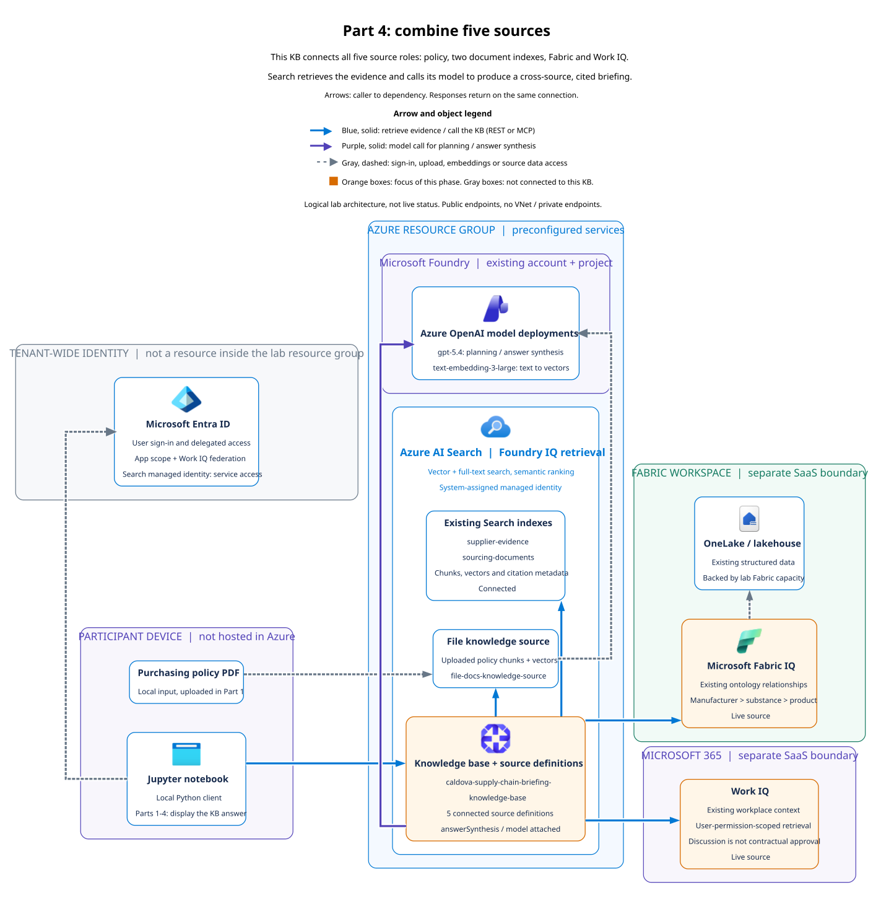

# Visual field guide

Use the notebook, its architecture map, and the relevant portal side by side. At each checkpoint, connect three observations: what changed, where it exists, and how you know it worked.

## Reading the architecture

All notebook boundary views follow Part 1's selective transparency: background identity uses 18% opacity, existing model services and outer local/Azure boundaries use 55%, and focused build cards remain fully readable. Parts 2-5 also subdue reused evidence sources at 55% and the earlier policy-upload path at 18%. They do not apply a blanket fade to all nodes, labels, or arrows. Before views retain faint planned query connections and dashed target outlines. After views show the completed query connections at full strength.

Start with the [overall service map](../img/architecture/azure-overview.svg) and [service-role explanation](../README.md#which-service-does-what). The [notebook-directory README](../src/notebooks/README.md) gives a compact route through all five parts.



**Architecture in brief:** This KB connects all five source roles: policy, two document indexes, Fabric and Work IQ. Search retrieves the evidence and calls its model to produce a cross-source, cited briefing.

**Step by step:**

1. Configure the notebook and acquire delegated authorization through Entra ID before querying live Fabric and Work IQ sources.
2. Create source definitions and a separate combined KB with five sources: policy, supplier evidence, sourcing documents, Fabric ontology and Work IQ.
3. Follow the solid blue notebook-to-KB arrow to submit the cross-source question.
4. Follow the outgoing blue arrows to the evidence sources. The indexes box counts as two sources. Fabric accesses existing OneLake relationships and Work IQ queries existing workplace context.
5. Follow the purple KB-to-Azure OpenAI arrow for planning and answer synthesis. Remote source data is not bulk-copied into Search.
6. Read the cited briefing in the notebook. Compare activity and references with each claim rather than assuming every connected source contributed.

Official icons identify the Azure, Fabric, and Entra services. Boundaries distinguish the local device, Azure resource group, Fabric SaaS workspace, Microsoft 365, and tenant-wide identity. Arrows point from caller to dependency, with responses implied on the same connection. Blue indicates retrieval, purple indicates model calls, and dashed gray indicates identity or ingestion. Orange marks focused objects. Disconnected sources have gray cards and no retrieval edge. Text labels provide the same information without relying on color.

Connections use thicker, right-angled arrows with larger heads. Model calls and authentication have dedicated routing lanes outside service headings. A white gap at a crossing means the lines are not connected. Every diagram has a visible legend with colored sample arrows and plain-text meanings. Long operation labels remain available as SVG hover text rather than overlaid on arrows.

| Visible connection | Meaning | How to follow it |
| --- | --- | --- |
| Blue, solid arrow | Retrieval or a call to the KB, through REST or MCP | Start at the local client, then follow the KB to its connected evidence sources |
| Purple, solid arrow | Model calls for planning or answer synthesis | In Parts 1-4 the KB calls the model. In Part 5 the local agent calls it directly |
| Gray, dashed arrow | Supporting sign-in, ingestion, embedding or source-data access | Identify its endpoints. Notebook to Entra is sign-in, PDF to file source is upload, file source to model is embedding, and Fabric IQ to OneLake is structured-data access |
| Orange box | Object in focus for this phase | This is a learning highlight, not a successful deployment status |
| Gray box | Component not used or not connected to the focused KB | Do not assume it contributes to this phase's answer |

The notebooks keep two architecture images each, at the beginning and end. Each part has distinct `partN-before` and `partN-after` images. Parts 2-5 show new build targets in dashed orange with faint planned arrows before the exercise, then solid orange with visible connections in the recap. Existing sources and services are faded. Opaque covers hide unused source boundaries. Part 2 covers Work IQ, Part 3 covers the separate Fabric branch, and Part 5 covers both. Part 4 leaves all five source roles visible and highlights only the new combined KB. Part 5 highlights the local agent and its extractive KB, not a hosted agent or a KB model. These diagrams describe intended configuration, not verified deployment state. Detailed walkthroughs and supplementary process strips remain companion material instead of being repeated before every section. Retrieval can overlap, so walkthroughs are not serial execution traces.

The architecture is grounded in `infra/main.bicep` and notebook calls. The lab uses public endpoints and does not provision a VNet, private endpoints, or a hosted agent. Optional indexing Blob Storage is disabled by default and omitted from this runtime view. Fabric capacity is an Azure preparation resource, while the workspace and its data remain a separate SaaS boundary. These are architecture references, not live health dashboards.

| Stage | Focused KB | Sources |
| --- | --- | --- |
| [Foundation](../img/architecture/azure-start.svg) | None created by the attendee yet | Preconfigured services, data, and identity prerequisites |
| [Policy](../img/architecture/azure-policy.svg) | `caldova-policy-knowledge-base` | Uploaded purchasing policy |
| [Documents](../img/architecture/azure-documents.svg) | `caldova-supply-chain-knowledge-base` | Policy, supplier evidence, sourcing documents |
| [Fabric](../img/architecture/azure-fabric.svg) | `caldova-fabric-knowledge-base` | Part 1 sources plus Fabric ontology |
| [Work IQ](../img/architecture/azure-workiq.svg) | `caldova-workiq-knowledge-base` | Part 1 sources plus Work IQ, without Fabric |
| [Combined](../img/architecture/azure-combined.svg) | `caldova-supply-chain-briefing-knowledge-base` | All five sources |
| [Local agent](../img/architecture/azure-agent.svg) | `caldova-supply-chain-minimal-knowledge-base` | Part 1 sources, extractive output, no attached model |

The hosted lab preconfigures Search, model deployments, indexed data, Fabric items, and Work IQ identity prerequisites. The notebooks mainly create Search data-plane objects. Creating a KB is not provisioning another Azure service.

Supplementary architecture guides and process strips are learning aids, not original product screenshots. They remain available as generated assets but are not embedded between notebook exercises. Architecture depicts a target, not proof that the preceding code created every object. Authentication and local agent steps do not create portal resources.

## Build, see, verify

The added cells perform read-only checks. A failed configuration check raises an error rather than displaying a completed status. Correct the preceding configuration or access issue before continuing.

| Checkpoint | Where to look | What to observe |
| --- | --- | --- |
| Foundation | Search service > **Search management > Indexes** | `supplier-evidence` and `sourcing-documents`, with nonzero document counts |
| Foundation | Microsoft Foundry > model deployments | Existing `gpt-5.4` and `text-embedding-3-large` deployments |
| Policy upload | Search > **Agentic retrieval > Knowledge sources** | A `file` source named `file-docs-knowledge-source`. Compare uploaded files with the notebook's ingestion table |
| Policy KB | Search > **Agentic retrieval > Knowledge bases** | `caldova-policy-knowledge-base`, one source, synthesis model attached |
| Three-source KB | Search > **Agentic retrieval > Knowledge bases** | `caldova-supply-chain-knowledge-base`, three source references |
| Fabric | Fabric workspace and ontology | Preconfigured lakehouse and ontology, manufacturer to active substance to medicinal product relationships |
| Fabric connection | Search > **Agentic retrieval > Knowledge sources** | `fabric-ontology-knowledge-source` pointing at the lab workspace and ontology |
| Work IQ prerequisites | Entra > app registration | API permissions, exposed `access_as_user` scope, and federated credential. Inspect only, do not change or expose credentials |
| Work IQ and combined KBs | Notebook service read-back | Four or five exact source references, then actual activity and evidence |
| Agent KB | Search > **Agentic retrieval > Knowledge bases** | `caldova-supply-chain-minimal-knowledge-base`, three sources, `extractiveData`, minimal reasoning, no attached model |
| Local agent | Notebook tool-call table | A `knowledge_base_retrieve` call. There is no hosted Foundry agent to inspect |

The helper builds portal links from the local notebook configuration. Search falls back to the portal home page with your service name. Set the optional `AZURE_SEARCH_RESOURCE_ID` locally to link directly to the resource. Never put attendee-specific resource identifiers or credentials into shared notebooks.

Work IQ configuration is SDK/API-only in the documented preview. Do not substitute an invented Search portal editor. A portal that does not expose Work IQ cannot be used to safely edit a KB containing it. Inspect the Entra prerequisites and notebook read-back instead.

## Interpret the query, not just the answer

**What actually ran** shows returned operations, source names, reported durations, warnings, and errors. Rows are not a serial timing chart because retrieval operations can overlap.

**Which sources supplied evidence?** distinguishes a configured source from an observed call and a returned reference. References are attributed through `activitySource` and the matching activity `id`. Missing attribution remains explicitly unresolved.

Evidence cards preserve the reference ID and source role. Use the answer's citation markers to identify which references support each claim. Raw JSON is available in expandable details for fields that do not fit a card.

An active file source or a successful upload does not establish that a file is searchable. The policy answer and its file reference provide the end-to-end check. Similarly, an Entra app registration alone does not prove a user can retrieve workplace evidence.

## Genuine portal screenshot capture

Reference screenshots must come from a seeded lab environment, not a fabricated UI. They illustrate navigation and expected appearance, never an attendee's current status. Do not execute deployments or chargeable retrieval calls solely to manufacture screenshot states.

**Capture status, 20 October 2026:** 12 genuine Azure portal screenshots are embedded at 12 matching checkpoints across all five notebooks. Each image has a navigation path, inspection guidance, a capture date, and a redaction/annotation disclosure. The [capture manifest](../img/portal/captures.json) records the observed state, original and published SHA-256 hashes, editing policy, and placement or omission for all 31 numbered steps. Originals remain outside the repository.

Only appropriate Azure portal views are included. There are **no substitute notebook screenshots, simulated portal screens, or placeholder images** for local setup, delegated authentication, SDK-only configuration, query results, MCP tools, or local agent activity. Existing notebook code, execution counts, outputs, and architecture images are unchanged by this capture pass.

| Original capture | Placement | What it establishes |
| --- | --- | --- |
| Search indexes | Part 1, step 6 | Existing index names and observed document counts |
| Policy source and files | Part 1, step 3, with navigation guidance in step 2 | File source type, embedding deployment, generated index, and uploaded-file status. The shared screenshot is shown only once after upload |
| Policy KB | Part 1, step 4 | One configured source |
| Two indexed source definitions | Part 1, step 7 | Each source points to the intended existing index |
| Three-source KB | Part 1, step 8 | Policy plus the two indexed sources |
| Fabric ontology connection in Search | Part 2, step 3 | Connection type and the locations of workspace/ontology ID fields |
| Fabric KB | Part 2, step 4 | Four configured sources and the cross-boundary processing notice |
| Knowledge source inventory | Part 3, step 3 and Part 4, step 3 | Five service-level definitions, including Work IQ shown as Other |
| KB inventory | Part 3, step 4 and Part 4, step 4 | Four-source Work IQ and five-source combined KB membership, without opening unsupported editors |
| Extractive KB source and settings views | Part 5, step 3 | Three sources, Minimal reasoning, Extractive data, and no attached KB model |

**Read the real state, not an idealized success:** the policy view contains four uploads from repeated runs. Attendees should upload once for their own run. The source inventory explicitly says that Other sources are not supported in the portal. The KB list can still show their names, but this is not a Work IQ editor or evidence of successful retrieval. Gray masks conceal identifiers, and orange outlines are added annotations. No configuration values, source membership, status badges, or query answers were fabricated.

**Not captured:** Foundry model deployments require a separate Foundry sign-in in the connected browser. Fabric workspace/ontology graph and Entra application prerequisites have not been captured. Do not confuse the included Azure Search connection view with the Fabric graph.

Earlier local runs reported a Part 2 setup-variable error, Work IQ access failures in Parts 3 and 4, and a Fabric failure in Part 4. Published notebooks have cleared outputs and execution counts. The portal screenshots verify only the depicted configuration. They do not resolve those runtime issues or establish successful end-to-end access.

1. Sign in to the correct tenant in Edge. Verify the service name against the notebook's endpoint. A sign-in page, an empty subscription filter, or access denied does not establish that the resource is absent.
2. Navigate manually to the relevant view and wait for its data to load. Do not capture secrets, `.env`, tokens, user assertions, keys, personal mailbox items, or sign-in/account-picker screens.
3. Crop out account banners, browser chrome, tenant/subscription/resource IDs, environment-specific hostnames, and unrelated resources. Preserve the actual resource content being demonstrated. Do not change values in the UI to make the lab appear completed.
4. Save a small PNG under `img/portal/`, inspect it, and add a caption with capture date, part, actual observed state, navigation path, and any cropping/redaction. If you add numbered callouts, retain the original privately and document the annotations.
5. Embed the image at its matching notebook checkpoint with meaningful alt text. Keep the live read-back and navigation instructions, since a reference screenshot is not runtime validation.

Only publish captures whose depicted state has actually been verified. If a resource or portal feature is unavailable, document that gap instead of adding a placeholder or synthetic screenshot.

## Concept illustrations

The [notebook README](../src/notebooks/README.md) introduces evidence roles, retrieval grounding, and Azure resource scopes. The following optional reference catalog keeps all detailed concepts outside the notebook exercise flow. These are original conceptual drawings grounded in the lab code, not reproduced presentation pages. They contain no facilitator answers or private query results.

| Concept | Relevant exercise or reading | What to notice |
| --- | --- | --- |
| [Five evidence roles](../img/concepts/evidence-roles.png) | README scenario, optional preparation for Part 4 step 5 | Policies, operational facts, commitments, relationships and current discussion have different authority |
| [Retrieval grounding](../img/concepts/retrieval-grounding.png) | README mental model | Retrieved evidence makes answers inspectable, not automatically correct |
| [Azure scopes](../img/concepts/azure-scopes.png) | README service roles | Fabric and Microsoft 365 are outside the Azure resource-group container |
| [Model roles](../img/concepts/model-roles.png) | Optional preparation for Part 1 step 2 | Embedding produces vectors, while the chat model handles language |
| [Ingestion](../img/concepts/document-ingestion.png) | Optional preparation for Part 1 step 3 | File ingestion prepares passages, vectors and metadata, unlike connecting existing indexes |
| [Source versus KB](../img/concepts/source-versus-kb.png) | Optional preparation for Part 1 step 4 | Connections can be reused by separate KB variants |
| [Index anatomy](../img/concepts/index-anatomy.png) | Optional preparation for Part 1 step 6 | Text, vectors and source metadata serve different purposes |
| [Citation trail](../img/concepts/citation-trail.png) | Optional reference for Part 1 citations | Match reference IDs and activity IDs, then inspect the actual evidence |
| [Authorization lanes](../img/concepts/authorization-lanes.png) | Optional preparation for Part 2 step 2 | Search credentials do not grant Fabric or Microsoft 365 access |
| [Ontology relationships](../img/concepts/ontology-relationships.png) | Optional preparation for Part 2 step 3 | Explicit directed relationships are not inferred document mentions |
| [Workplace versus commitment](../img/concepts/workplace-versus-commitment.png) | Optional preparation for Part 3 step 5 | A proposed date does not amend an approved purchase order |
| [Answer boundary](../img/concepts/answer-boundary.png) | Optional preparation for Part 5 step 3 | Extractive KB output is evidence for a local agent's separate model call |

### Selection from the 26-slide primer

The full primer was reviewed for complementary teaching concepts. The selection below explains omissions as well as additions. The editable sources and public assets do not include the original slides, protected speaker notes, or presentation screenshots.

| Primer slides | Decision |
| --- | --- |
| 1 | Omit decorative cover |
| 2, 3, 5 | Keep existing architecture and service-role explanations rather than duplicate them |
| 4, 21 | Combine into evidence roles and the Part 4 source-authority checkpoint |
| 6 | Add Azure hierarchy with separate Fabric and Microsoft 365 boundaries |
| 7 | Add chat versus embedding model roles |
| 8, 13 | Combine retrieval grounding with the existing activity guides and citation inspection, without claiming a rigid runtime sequence |
| 9 | Add ingestion versus connection to prepared indexes |
| 10 | Add index-record anatomy and retrieval strategies |
| 11, 12 | Combine into source versus KB and separate authorization contexts |
| 14, 22 | Combine into the two output patterns and the local-agent synthesis boundary |
| 15 | Add the citation/reference/activity trace, using explicitly illustrative IDs |
| 16, 17 | Keep the correct README branch route and existing Part 1 architecture, omit facilitator answers |
| 18 | Add separate Search, Fabric and Work IQ authorization lanes |
| 19 | Add entity types and explicit directed relationships, without invented instance links |
| 20 | Add workplace context versus approved commitments |
| 23 | Keep existing setup and troubleshooting, without fixed timing guarantees |
| 24, 25, 26 | Keep existing glossary and learning links instead of turning them into more images |

Important distinctions: sources are connection definitions, not universally data stores. Parts 2 and 3 branch from Part 1 and create separate KBs. The policy-only KB does not explicitly set low reasoning, although the multi-source synthesis KBs do. Part 5 changes both reasoning and output settings and has no attached KB chat model. These illustrations explain those choices without changing them.

## Maintaining the visuals

The twelve concept diagrams have deterministic SVG, PNG, and editable `.excalidraw` sources under `img/concepts/`. Text remains black, container backgrounds are transparent, and every SVG has an accessible title and description. PNG previews are clickable at their teaching positions. Regenerate all three formats locally with the existing `resvg-py` environment:

```powershell
.\.venv\Scripts\python.exe scripts\build-concept-diagrams.py
.\.venv\Scripts\python.exe -m unittest tests.test_concept_diagrams
```

Edit the generator, not a generated image. Keep concept illustrations in companion documentation rather than adding `lab-concept-guide` cells to the notebooks. Each notebook should show only its opening and closing architectures plus matching genuine portal captures. Preserve executable cells, saved outputs, execution counts, and notebook metadata. Concept illustrations are separate from `img/portal/` and its capture manifest. They do not fill missing portal views or assert successful remote access.

The eight primary service architectures are generated locally as self-contained SVG, PNG, and editable Graphviz `.dot` sources. The same generator derives ten staged notebook SVG/PNG images, two per part. Edit `build_part1_reveal` or `PART_REVEALS` and `build_part_reveal` for their captions, focus, opacity, and covers, rather than editing generated images. The generator also writes `descriptions.json` and `walkthroughs.json` for shared reference captions and numbered reading steps. Keep the Markdown explanations beside README and notebook images synchronized with those manifests when changing a phase. Graphviz lays out the topology, then the SVG routing pass moves model and identity lines into dedicated lanes to avoid container headings and separates crossings visually. Regenerate through the Python script rather than running `dot` alone to retain this routing. Install Graphviz separately and make `dot` available on PATH, or use the standard Windows installation location. The rendering environment also requires `resvg-py`. No browser, cloud deployment, or external rendering service is used:

```powershell
.\.venv\Scripts\python.exe scripts\build-azure-architecture.py
```

Unmodified official Azure V24, Fabric, and Entra SVG icons are vendored under `img/architecture/icons/`. Their [provenance manifest](../img/architecture/icons/sources.json) records official download links, archive paths, and SHA-256 hashes. The renderer checks those hashes and current purple Foundry branding. Refresh from the official sources when branding changes. Product icons represent services, not custom lab components. Do not recolor or distort them.

The earlier 24 schematic maps and learning strips remain available with editable `.excalidraw` sources. They are supplementary process aids, not the primary Azure architecture:

```powershell
python scripts\build-lab-diagrams.py
```

Change the relevant generator, then regenerate all its formats. Do not hand-edit a generated image. Keep source roles, focused KB names, cloud/local boundaries, and the Part 5 synthesis boundary accurate.

Run offline checks from the repository root using the workshop virtual environment:

```powershell
.\.venv\Scripts\python.exe -m unittest discover -s tests -v
```

The targeted visual checks are:

```powershell
.\.venv\Scripts\python.exe -m unittest discover -s tests -p "test_*visual*.py" -v
```

These checks validate presentation, error paths, notebook structure, local links, the eight official-icon architectures, all 24 supplementary diagram pairs, and the streamlined layout with two boundary architectures and matching portal captures. They accept either cleared notebooks or successful saved execution results. Visual simplification preserves code, execution counts, configuration read-back, query answers, references, and activity results. Clear outputs and reset execution counts before committing notebooks, as required by `AGENTS.md`. The checks do not deploy resources, authenticate a user, or prove live Fabric/Work IQ retrieval.

## Product references

Portal functionality can change during preview. Consult the official documentation when refreshing captures:

- [Portal agentic retrieval quickstart](https://learn.microsoft.com/azure/search/get-started-portal-agentic-retrieval).
- [File knowledge sources](https://learn.microsoft.com/azure/search/agentic-knowledge-source-how-to-file).
- [Fabric ontology knowledge sources](https://learn.microsoft.com/azure/search/agentic-knowledge-source-how-to-fabric-ontology).
- [Work IQ knowledge sources and supported interfaces](https://learn.microsoft.com/azure/search/agentic-knowledge-source-how-to-work-iq).
