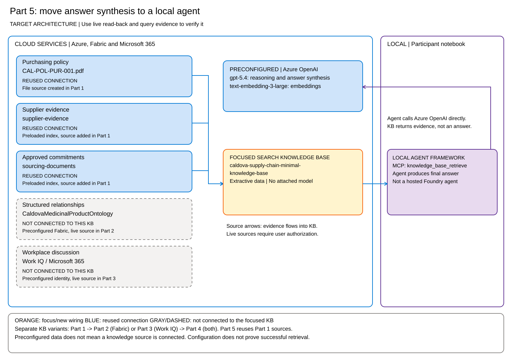

===
# Summary

You've completed five notebooks on building agentic knowledge bases with Foundry IQ (Azure AI Search), Fabric IQ, Work IQ, and a local Agent Framework client.

## What you built

| Part | Architecture outcome | How you verified it |
| --- | --- | --- |
| 1 | A policy KB and a three-source Caldova KB | File ingestion status, source read-back, and policy/document references |
| 2 | A separate KB with a live Fabric ontology source | Four-source membership and structured relationship evidence |
| 3 | A separate KB with a live Work IQ source | Four-source membership and user-authorized workplace evidence |
| 4 | A KB combining all five sources | Configuration read-back, actual source activity, and attributed references |
| 5 | An extractive KB over the Part 1 sources and a local agent using MCP | No model on the KB, recorded retrieval tool calls, and an agent-synthesized answer |

Parts 2 and 3 branch from the Part 1 source set. Part 4 combines them. Part 5 deliberately returns to the three Part 1 sources. These are separate KB variants, not one KB that gains sources in every notebook.

Remember the three different checks: an architecture map describes intended wiring, read-back confirms configuration, and query activity plus citations show the evidence actually retrieved. A configured source does not have to be selected for every question.

## Continue learning

- [Foundry IQ (Azure AI Search)](https://learn.microsoft.com/azure/search/) - Explore the full capabilities of Foundry IQ (Azure AI Search) and how it integrates with other Azure services.
- [Design an index for agentic retrieval in Foundry IQ (Azure AI Search)](https://learn.microsoft.com/azure/search/search-agentic-retrieval-how-to-index) - Best practices for structuring your data for agentic retrieval.
- [Create a knowledge base in Foundry IQ (Azure AI Search)](https://learn.microsoft.com/azure/search/search-agentic-retrieval-how-to-create?tabs=rbac%2Cpython-get-agents%2Cpython-create-agent%2Cpython-query-agent%2Cpython-delete-agent) - Step-by-step guide to creating and configuring knowledge bases.
- [Create a knowledge source](https://learn.microsoft.com/azure/search/search-knowledge-source-overview) - Understand how to create and configure different data sources.
- [Use answer synthesis for citation-backed responses in Foundry IQ (Azure AI Search)](https://learn.microsoft.com/azure/search/search-agentic-retrieval-how-to-synthesize) - Learn how to generate grounded answers with citations using answer synthesis.

## Next steps

Here are some ways to apply what you've learned:

**Query from more MCP clients** - Connect the knowledge base MCP endpoint to compatible clients such as GitHub Copilot CLI.

**Customize retrieval behavior** - Adjust reasoning effort levels, configure custom retrieval and answer instructions for specific sources.

**Integrate with your data** - Replace the Caldova policy, supplier evidence, and sourcing documents with your own enterprise content while preserving evidence roles and access boundaries.

**Build a conversational interface** - Extend the local Agent Framework agent with additional tools and a chat UI for end users. Hosting the agent is a separate deployment step.

The patterns you explored in this lab form the foundation for building custom copilots, enterprise assistants, and intelligent knowledge applications that combine indexed enterprise data with structured and workplace context.
