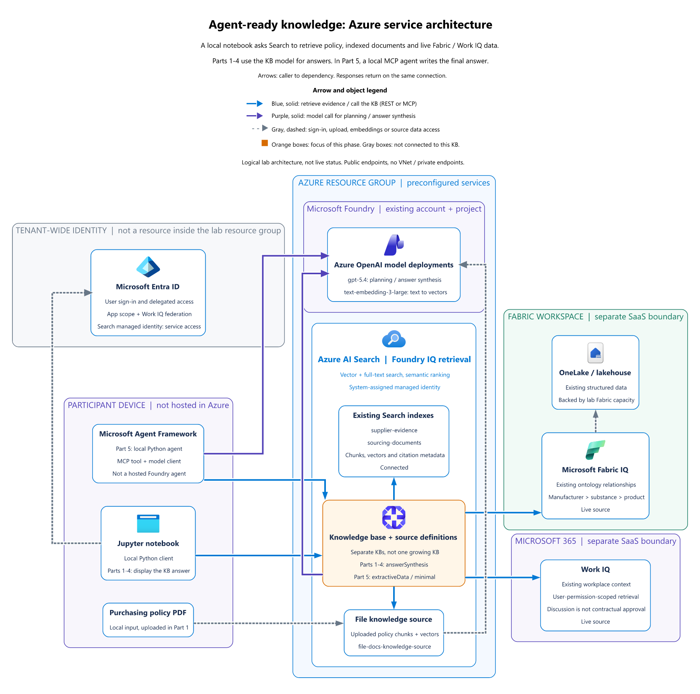
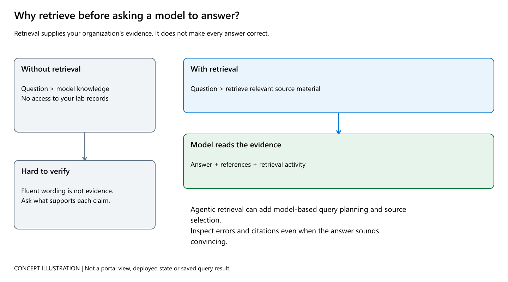
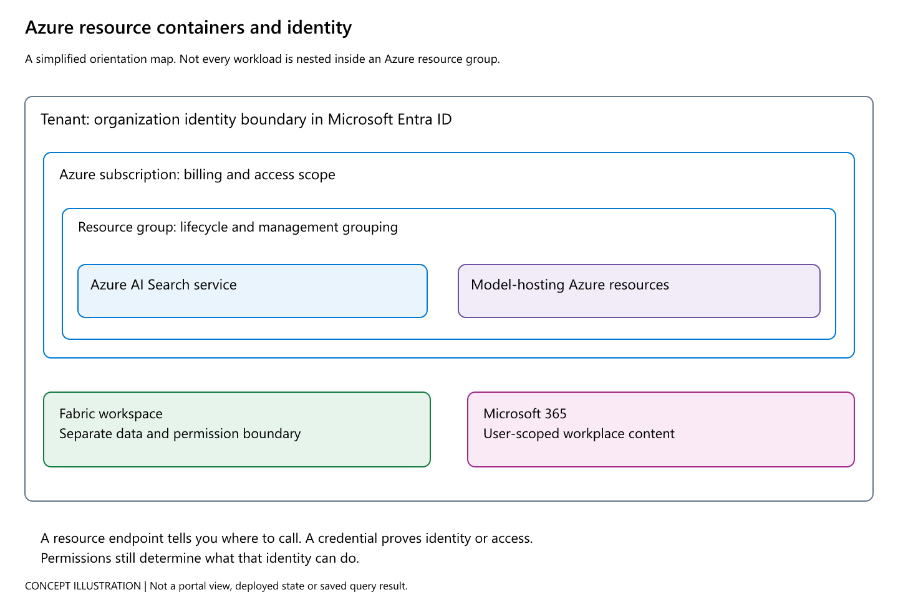

# A guide to the notebook architecture

New to Foundry IQ, Fabric IQ, or Work IQ? Start here. This guide explains the picture before you run the notebooks: what problem the services solve, how information moves, what each component contributes, and what to look for as you work through the lab.

## The problem this lab explores

Imagine you are an analyst at Caldova preparing a supplier-risk briefing. The answer may depend on several kinds of evidence:

- A **policy file** explains what the organization requires.
- **Supplier and sourcing documents** provide records such as invoices, agreements, and quality evidence.
- **Structured business data** connects products, substances, and manufacturers.
- **Workplace context** can reveal what colleagues recently discussed.

These sources are not interchangeable. A policy states a rule. A document is evidence. Structured data describes known relationships. A conversation may be useful context, but it is not automatically an approved decision. The goal is to let an AI experience find relevant evidence across these systems and show where its answer came from, while keeping each source's meaning and access rules intact.

[](../../img/concepts/evidence-roles.png)

These **concept illustrations** explain how to think about the lab. They are not portal screenshots or proof of a successful query. Click any illustration to enlarge it. Detailed concepts stay in this README and the [visual field guide](../../docs/visual-guide.md#concept-illustrations), not in the notebook exercise flow.

## First, read the architecture as a story

**Open the [full-size architecture diagram (PNG)](../../img/architecture/azure-overview.png)** if the image preview below is not visible in your Markdown viewer.

[](../../img/architecture/azure-overview.png)

The diagram is the **target wiring for this hosted lab**, not a requirement to deploy every box yourself. Follow the arrows from the notebook on your computer, through the retrieval and model components, to the evidence sources. The answer and its references come back to the notebook.

1. **You ask a question** from a Jupyter notebook running on the lab computer.
2. **A knowledge base coordinates retrieval.** It uses the connected sources to find information relevant to the question. For some sources it can ask follow-up queries or choose which source to consult.
3. **The connected sources provide different kinds of evidence.** Search indexes return document passages. Fabric IQ provides structured relationships. Work IQ provides workplace context available to the signed-in user.
4. **A model helps make sense of the evidence.** In Parts 1–4, the model is attached to the knowledge base. In Part 5, the knowledge base returns evidence to a local agent, which asks a model to compose the answer.
5. **You inspect the result.** Check the answer, references, retrieval activity, and any warnings. A plausible answer is not enough if the evidence does not support it.

### How to read the visual

- **Blue arrows** show retrieval and evidence flow. **Purple arrows** show model calls. **Dashed gray lines** show identity or ingestion relationships.
- The boxes mark boundaries: your local device, the Azure resource group, the Fabric workspace, Microsoft 365, and the tenant-wide identity service. They help show which component runs where.
- The compact learning sequence inside each notebook is a guide to the exercise, not another architecture diagram.
- The diagram shows public endpoints for this lab. It is not a private-network production design.

The Search service, model deployments, Fabric workspace, and work context are already prepared in the hosted lab. Most exercises create or configure **knowledge sources and knowledge bases inside the existing Azure AI Search service**. Creating a knowledge base does not deploy another Azure service.

## A simple mental model

Think of the knowledge base as a **research coordinator**, not as a new warehouse that contains every company's data. It knows which sources it can consult and helps retrieve relevant evidence. The evidence remains in its original system or in an existing Search index.

For this lab, keep three activities separate:

- **Connect:** define which source a knowledge base can use.
- **Retrieve:** find relevant passages, records, or relationships for a question.
- **Synthesize:** use a language model to write a readable answer from the retrieved evidence.

The notebooks let you see these steps and their boundaries rather than treating "the AI" as one mysterious component.

[](../../img/concepts/retrieval-grounding.png)

Retrieval does not guarantee correctness. It gives you evidence to check. Follow the [citation trail](../../img/concepts/citation-trail.png) from an answer marker to its reference, the source activity, and the underlying record. A configured connection is not proof that the source was called or cited.

## What each name means here

| Name | In everyday terms | Its role in this lab |
| --- | --- | --- |
| **Azure AI Search index** | A prepared, searchable collection of document passages | Holds chunks of supplier or sourcing documents, their vectors, and citation details. It supports text and vector search with semantic ranking. The two indexes are already populated. |
| **Knowledge source** | A connection or adapter to a particular source | Tells a knowledge base how to reach an uploaded file, an existing Search index, Fabric, or Work IQ. It is not another copy of all that source's data. |
| **Knowledge base (Foundry IQ)** | A coordinator for finding evidence across connected sources | Orchestrates retrieval. In Parts 1–4, it can also use an attached model to plan and synthesize an answer. The exercises create separate knowledge bases to compare source combinations. |
| **Embedding model** | A way to represent text by meaning so similar ideas can be found | `text-embedding-3-large` supports vector retrieval. It helps find relevant content; it does not write the final answer. |
| **Chat model** | The language model that interprets instructions and writes text | `gpt-5.4` helps plan and synthesize answers. In Parts 1–4 it is called through the knowledge base. In Part 5 the local agent calls it. |
| **Fabric IQ** | Structured business information and the relationships between it | The preconfigured Fabric ontology exposes relationships such as manufacturer, substance, and medicinal product over OneLake data. It is not simply another document index. |
| **Work IQ** | Relevant work context available to the signed-in person | Provides workplace information using the user's permissions. A discussion can inform an investigation, but does not by itself establish an approved commitment. |
| **Microsoft Entra ID** | The identity and access-control layer | Sign-in and delegated authorization determine which protected information a user can access. A Search admin key does not grant Fabric or Microsoft 365 access. |
| **MCP** | A standard way for an agent to call a tool | In Part 5, MCP exposes the knowledge base retrieval operation `knowledge_base_retrieve` to the local agent. MCP is a protocol and connection, not another deployed Azure service. |
| **Agent Framework agent** | A Python program that decides when to use a tool and how to answer | Part 5 runs this agent locally in the notebook. It is not a hosted agent deployed in Foundry. |

Optional Blob Storage is part of the document preparation and indexing pipeline. The notebooks do not query it as an additional source. Fabric and Microsoft 365 remain remote sources rather than being bulk-copied into the Search indexes.

### Where do those resources live?

[](../../img/concepts/azure-scopes.png)

A **tenant** identifies the organization for sign-in. An Azure **subscription** provides billing and access scope. A **resource group** organizes related Azure resources for management. Fabric workspaces and Microsoft 365 content are not folders inside your Search resource group.

An **endpoint** is the address of a service. A credential proves identity or grants service access, and permissions determine what that identity can do. See the [authorization lanes](../../img/concepts/authorization-lanes.png) before Parts 2 and 3. The lab's Search admin key does not grant access to Fabric or Microsoft 365.

For the two easily confused model roles, see [chat model versus embedding model](../../img/concepts/model-roles.png). For the change in Part 5, see [who writes the final answer](../../img/concepts/answer-boundary.png).

## Your route through the notebooks

The five notebooks compare different source combinations and two ways to produce an answer. The branches matter: Parts 2 and 3 each start from the Part 1 sources. Part 4 combines the source types. Part 5 intentionally uses the Part 1 sources with a different retrieval and agent pattern.

| Notebook | What you add or explore | What to look for |
| --- | --- | --- |
| [Part 1: Foundry IQ knowledge bases](part1-standard-foundry-iq-kb.ipynb) | Upload a policy file, then connect it with two prepared Search indexes. This notebook has a policy exercise followed by a multi-document exercise. | Confirm which sources are connected. Ask questions that need policy and supplier evidence, then inspect the returned references and citations. |
| [Part 2: Fabric IQ](part2-fabric-iq-to-kb.ipynb) | Create a separate knowledge base that adds the Fabric ontology to the Part 1 source types. | Look for structured relationships and source attribution. Notice the identity and delegated-access requirements for Fabric. |
| [Part 3: Work IQ](part3-work-iq-to-kb.ipynb) | Create another separate knowledge base that adds Work IQ to the Part 1 source types. It does not include Fabric. | Compare workplace context with document evidence. Check the identity prerequisites and distinguish discussion from an approved commitment. |
| [Part 4: Work IQ and Fabric IQ](part4-work-iq-fabric-iq-to-kb.ipynb) | Combine the document, Fabric, and Work IQ source roles in one knowledge base. | Follow which sources were actually called. Use citations and activity to see what supports each part of the answer. |
| [Part 5: Agent Framework and MCP](part5-agent-framework-mcp.ipynb) | Build a local Python agent that calls an extractive knowledge base over MCP. The agent, rather than the knowledge base, composes the final answer. | Inspect the `knowledge_base_retrieve` tool calls and the evidence passed back to the agent. This is a local agent, not a hosted deployment. |

### Keep the branch structure in mind

```text
Part 1: policy + document indexes
             ├── Part 2: add Fabric IQ
             ├── Part 3: add Work IQ
             └── Part 4: combine Fabric IQ + Work IQ

Part 5: Part 1 source types + extractive retrieval + local agent
```

Each branch creates a **different knowledge base**. Parts 2 and 3 do not successively modify the same one, and Part 5 does not connect an agent to the five-source Part 4 knowledge base.

## How to work through each exercise

Each notebook contains just two architecture images: a dedicated before view near the beginning and an after view near the end. Part 1 starts with the policy-only build and ends with the policy and index source configuration. Parts 2-5 use dashed orange cards and faint planned connections at the start, then solid orange cards and visible connections for the completed configuration. Existing data and services stay faded. Part 2 highlights the Fabric connection and covers Work IQ. Part 3 highlights the separate Work IQ branch and covers Fabric. Part 4 distinguishes four Search source definitions created or updated in the notebook from the existing data, and connects them with the reused policy source to a separate five-source KB. Part 5 follows your question to a local agent with two helpers: a KB that finds evidence and a chat model that helps reason and write. MCP is a labeled connection, not separate SDK and endpoint boxes. Unused Fabric, Work IQ and earlier ingestion paths are omitted from this focused runtime view. These are intended configurations, not live deployment checks. Click an image to open its full-size PNG. Between these boundaries, only matching genuine portal screenshots interrupt the exercises. Concept illustrations, section maps, and repeated comparison blocks are kept out of the notebook flow.

1. **Before you run code:** read the architecture at the beginning of the notebook. Orange highlights the services or connections introduced in that part.
2. **Build or connect:** run the code and note what the notebook creates versus what the lab already provides.
3. **Inspect:** use matching portal screenshots and their navigation captions, then check actual configuration or query evidence.
4. **Review and verify:** return to the architecture recap at the end, then compare its intended wiring with the service read-back and actual query activity, references, and citations. A diagram is not proof that a resource exists or a query succeeded.

The notebooks now include **12 original Azure portal screenshots at 12 matching checkpoints**, with the navigation path, fields to inspect, and an explanation of what the view does and does not prove. Part 1 Step 2 retains navigation guidance and refers to the shared screenshot in Step 3 rather than repeating it. Click an image to enlarge it. These captures show the deployed lab on **20 October 2026**, not the live state of your resources.

Gray blocks hide environment identifiers. Orange outlines are added reading aids, not deployment status. Actual source membership, file status, model settings, and portal limitations are preserved. For example, the portal lists Work IQ as **Other**, and the policy file view contains repeated uploads from earlier runs. Neither is an instruction to recreate those details.

**No matching Azure portal view means no added screenshot.** Local configuration, delegated sign-in, MCP client objects, and local agent activity do not receive invented portal screens or notebook substitute images. Foundry model deployment, Fabric workspace/ontology graph, and Entra prerequisite captures are not included. The Fabric screenshot shows the Search connection in Azure portal, not the Fabric graph. See the [capture coverage and provenance](../../docs/visual-guide.md#genuine-portal-screenshot-capture).

If you capture screenshots yourself, crop account banners, browser chrome, resource IDs, hostnames, keys, and personal workplace content. Do not change actual source membership or model/output settings. Clearly label any redaction or illustrative replacement.

## Ready to start?

Use the [lab setup guide](../../instructions/overview.md), select the lab's `.venv` kernel in Jupyter, and open [Part 1](part1-standard-foundry-iq-kb.ipynb). The setup guide covers sign-in and the resources that are already prepared for you.

For the complete service-to-portal map and session context, see the [main workshop README](../../README.md#the-bigger-picture).
